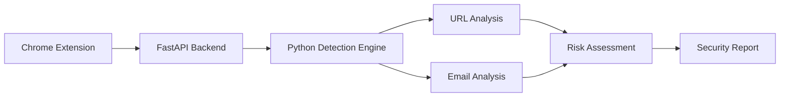

# 🛡️ Phishing Guard – AI-Powered Browser Security Extension

<p align="center">
  
  
  
  
</p>

**Phishing Guard** is a browser-based security extension that helps identify potential phishing websites and suspicious emails through automated analysis and risk assessment.

Built using a Chrome Extension frontend and a Python FastAPI backend, it analyzes suspicious URLs and email content, identifies phishing indicators, and presents understandable security findings.

## ✨ Key Features

- **Website Phishing Detection:** Automatically detects the active tab URL and supports manual website scanning.
- **Email Phishing Analysis:** Examines sender details, email headers, suspicious phrases and embedded URLs.
- **Brand Impersonation Detection:** Identifies potential attempts to impersonate trusted brands.
- **Risk Assessment:** Generates risk scores, LOW/MEDIUM/HIGH classifications and security verdicts.
- **HTML Security Reports:** Presents website scan results with findings, risk summaries and recommendations.
- **Local API Integration:** Connects the Chrome extension to a Python-based detection engine through FastAPI.

## 🏗️ Architecture



## 🧰 Technology Stack

| Technology | Purpose |
|---|---|
| Python | Detection engine |
| FastAPI | Backend API |
| JavaScript | Extension functionality |
| HTML5 & CSS3 | User interface and reports |
| Chrome Manifest V3 | Browser extension framework |

## 📸 Project Screenshots

### Extension Interface


### Website Security Report


## ⚙️ Run Locally

**1. Clone the repository**

```bash
git clone https://github.com/mohammaddanishm855/Phishing-Guard-Extension.git
cd Phishing-Guard-Extension
```

**2. Create and activate a virtual environment**

```bash
python -m venv venv
venv\Scripts\activate
```

**3. Install dependencies**

```bash
pip install fastapi uvicorn python-multipart requests python-dotenv
```

**4. Start the backend**

```bash
cd backend
python -m uvicorn main:app --reload
```

**5. Load the extension**

- Open `chrome://extensions`.
- Enable Developer Mode.
- Select **Load unpacked**.
- Choose the `extension` folder.

## 🔍 Project Highlights

- Modular Python-based detection engine.
- REST API integration between browser and backend.
- Heuristic-based phishing indicator analysis.
- Combined risk scoring and security reporting.
- Separate analysis workflows for websites and emails.


## 👨‍💻 Developer

**Mohammad Danish**

Cybersecurity | SOC Analysis | Python | Security Automation

[GitHub Profile](https://github.com/mohammaddanishm855)
